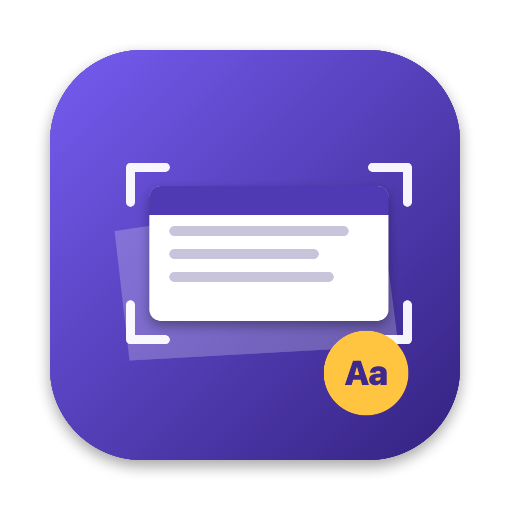

<p align="center"></p>

<h1 align="center">SlideSnap</h1>

<p align="center">
Photos of lecture slides → straight, clean slides + their text as Markdown.<br>
A small macOS app (Apple silicon). Everything runs on your Mac: no accounts, no cloud, no API keys.
</p>

<p align="center"><a href="#по-русски">По-русски ↓</a></p>

---

Many lecturers don't share their slides; you can only photograph the projector. The result is a pile of
skewed shots with a dark frame around them. SlideSnap turns that pile into something you can put in your notes:

- **finds the slide** on each photo, **straightens the perspective** and crops it (keeping the coloured title bar of the template);
- **reads the text** with Apple Vision (Russian, English, Ukrainian, German, French, Spanish);
- **drops repeated shots** of the same slide;
- **strips photo metadata**, including GPS location, from the saved images;
- optionally **attaches what the lecturer said** to each slide from a transcript — by capture time for photos, by matching words for PDFs;
- writes `slides.md` — titles, slide text and speech, ready for Obsidian or any Markdown editor, and compact enough to hand to an AI model to write notes instead of sending it dozens of images.

Input can be a folder of photos, individual photos, or a PDF that was assembled from such photos.

## Install

Download `SlideSnap.zip` from [Releases](../../releases), unzip, move **SlideSnap.app** to Applications.

The app is not notarized by Apple, so the first launch needs one extra step: **right-click → Open → Open**.
If macOS says the app is damaged, run once:

```bash
xattr -dr com.apple.quarantine /Applications/SlideSnap.app
```

Requires macOS 13 or later.

## Use

1. Drop photos, a folder or a PDF onto the window (or onto the Dock icon).
2. Optionally add the lecture transcript (`.txt`).
3. Press **Process** (⌘↩).

The output folder (by default next to the photos) gets `slide-01.jpg …`, `slides.md` and `slides.json`.
**Text for AI** copies `slides.md` to the clipboard.

If the output folder is inside an Obsidian vault, images are embedded as `![[path/slide-01.jpg]]`;
elsewhere as normal Markdown links.

### Transcripts

A transcript is plain text with time stamps, for example:

```
Speaker 1 (00:00)
Today we talk about shock…

Speaker 2 (12:34)
…
```

`[00:12:34] text` lines also work. For photos the start of the recording is taken from the file name of
voice-recorder files (`Voice 261015_162800.txt`, `2026-10-15 16.28.00.txt`); speech from 20 s before a
photo until 20 s before the next one goes to that slide. PDFs carry no capture time, so speech is matched
to slides by shared words (slides only move forward) — coarser, and slides without text (diagrams, photos)
get little.

### Settings

| | |
|---|---|
| Slide shape | 16:9, 4:3 or as shot |
| Slides have a coloured title bar | widens the crop to keep the header and footer of the template; turn off if the crop catches the edge of the screen |
| Text language | OCR language (+ English) |
| Image width | 1280–2560 px |

## Command line

The app bundle contains a CLI with the same engine:

```bash
/Applications/SlideSnap.app/Contents/Helpers/slidesnap lecture.pdf -o out --transcript lecture.txt
```

```
slidesnap <photos folder | file.pdf | photos…> -o <output folder>
          [--transcript file.txt] [--start "2026-10-15 16:28:00"]
          [--width 1600] [--aspect 16:9|4:3|0] [--pad-top 0.17] [--pad-bottom 0.11]
          [--lang ru-RU,en-US]
```

## Build from source

Needs only the Xcode Command Line Tools (`xcode-select --install`).

```bash
./scripts/build-app.sh      # → dist/SlideSnap.app and dist/SlideSnap.zip
swift run slidesnap --help  # CLI only
```

`Sources/SlideSnapCore` is the engine (detection, correction, OCR, transcript matching), `Sources/SlideSnapApp` the SwiftUI app, `Sources/SlideSnapCLI` the command line.

## Limits

- Slide detection expects a light slide on a darker screen/wall and a slide that fills most of the photo width. A slide that wasn't found is kept as the whole frame and marked in the app.
- The title-bar widening is tuned for templates with a header ~15 % of the slide height.
- OCR quality is Apple Vision's: good on printed text, weak on small text in diagrams.

## License

MIT

---

## По-русски

**SlideSnap** — приложение для macOS, которое превращает фотографии слайдов лекции в ровные, обрезанные слайды и их текст в Markdown.
Всё работает на самом Mac: без аккаунтов, облака и ключей API.

Сделано для ситуации, когда преподаватель не даёт файл презентации и слайды остаётся только фотографировать с проектора.

**Что делает:**
- находит слайд на фото, выравнивает перспективу и обрезает, сохраняя цветную шапку шаблона с заголовком;
- распознаёт текст (русский, английский, украинский, немецкий, французский, испанский);
- убирает повторные снимки одного слайда;
- удаляет из картинок метаданные фото, включая геопозицию;
- по желанию добавляет к каждому слайду слова лектора из транскрипта: для фото — по времени съёмки, для PDF — по совпадению слов;
- пишет `slides.md` — заголовки, текст слайдов и речь. Его удобно вставить в Obsidian или отдать нейросети для конспекта: текст обходится в разы дешевле, чем десятки картинок.

**Установка:** скачайте `SlideSnap.zip` в [Releases](../../releases), распакуйте и перенесите SlideSnap.app в «Программы».
Приложение не заверено Apple, поэтому первый запуск — **правый клик → Открыть → Открыть**.
Если macOS пишет, что приложение повреждено, один раз выполните в Терминале:
`xattr -dr com.apple.quarantine /Applications/SlideSnap.app`. Нужна macOS 13 или новее.

**Как пользоваться:** перетащите в окно фото, папку или PDF (можно и на иконку в Dock), при желании добавьте транскрипт лекции (`.txt`) и нажмите **«Обработать»** (⌘↩).
В папке результата появятся `slide-01.jpg …`, `slides.md` и `slides.json`; кнопка **«Текст для ИИ»** копирует `slides.md` в буфер обмена.
Если папка результата лежит внутри хранилища Obsidian, картинки вставляются как `![[путь/slide-01.jpg]]`.

**Транскрипт** — текст с метками времени вида `Спикер 1 (12:34)` или `[00:12:34] текст`. Время начала записи берётся из имени файла диктофона (`Голос 261015_162800.txt`).
